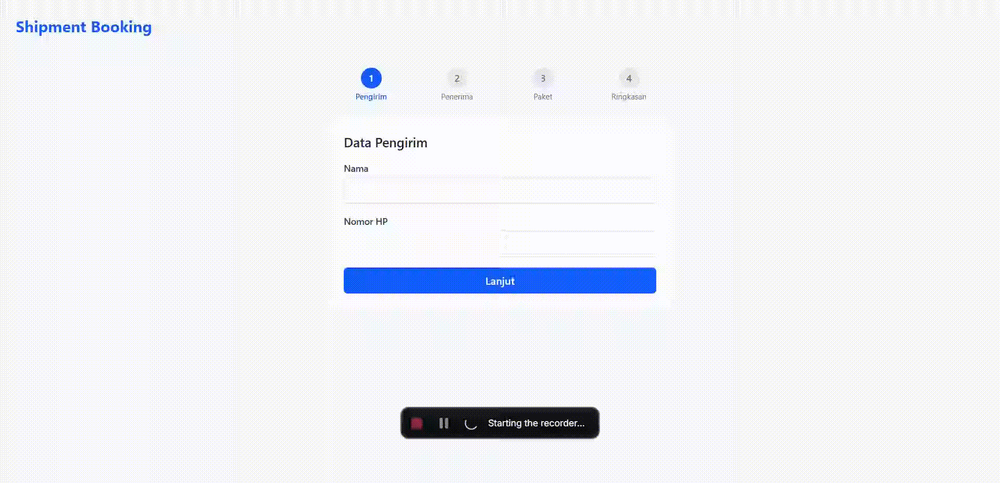

# Shipment Booking

A multi-step shipment booking flow built with **Angular** (standalone components, Signals, Typed Reactive Forms).

**Live demo:** <https://shipment-booking.vercel.app/>



## Features

- 4-step booking flow: Sender → Recipient → Package → Summary
- Cascading address selects (province → regency → district → village) using the public [Indonesian Regions API](https://github.com/emsifa/api-wilayah-indonesia)
- Typed Reactive Forms with a custom Indonesian phone number validator
- Wizard state shared across steps and preserved when navigating back
- Route guards that block access to a step until the previous ones are complete
- Global HTTP error handling with automatic retry and toast notifications
- Lazy-loaded routes, responsive layout (Tailwind CSS)
- Unit tests for the validator, store, and guard

## Tech stack

Angular <versi kamu> · TypeScript (strict) · RxJS · Signals · Tailwind CSS · Vercel

## Technical decisions

**Signals instead of NgRx.** The state is small, local to one feature, and has a single writer. A signal-based store (`BookingStore`) exposes read-only signals and mutation methods, which is simpler than actions/reducers/effects for this size. NgRx would make sense once state is shared across many features or needs time-travel debugging.

**`switchMap` for cascading selects.** Changing a parent select cancels the pending request for the old value, so a slow response can never overwrite the options of a newer selection.

**`ControlValueAccessor` for the select component.** `SelectField` works with `formControlName`, so the form keeps full control over validation, disabled state, and reset, while the markup lives in one reusable component.

**Interceptor order.** `errorInterceptor` wraps `retryInterceptor`, so the user sees one toast after retries are exhausted instead of one per attempt. Only GET requests are retried to avoid duplicating writes.

**Guards as functions.** `bookingStepGuard('sender', 'recipient')` is a guard factory that redirects to the first incomplete step.

## Limitations

- Wizard state lives in memory, so a page refresh restarts the flow (guards redirect to step 1).
- Shipping cost uses a mock rate table, not real courier pricing.
- Region data comes from a third-party static API and contains 34 provinces (it does not include the latest Papua provinces).
- The booking is not sent to a backend; this is a front-end demo.

## Getting started

```bash
git clone <URL repo kamu>
cd shipment-booking
npm install
ng serve
```

Open `http://localhost:4200`.

```bash
ng test       # unit tests
ng build      # production build
```

## Project structure

```
src/app/
├── core/       # models, services (API, store), interceptors, guards
├── features/   # booking flow, not-found page
└── shared/     # reusable components and validators
```
